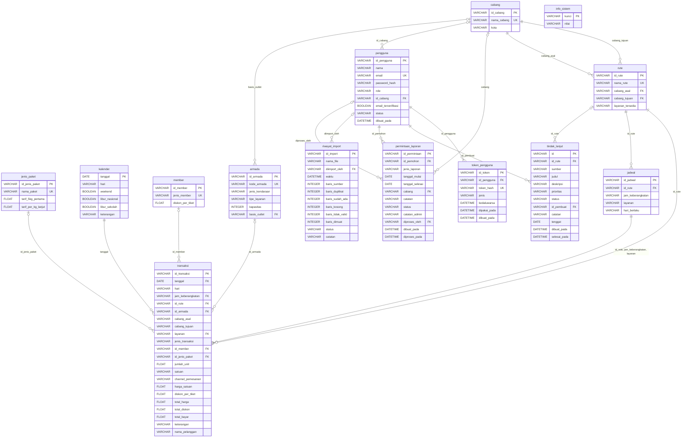

# ERD Database SIRADA Kencana

> Dibuat otomatis oleh `scripts/buat_erd.py` dari `app/models/models.py`. **Jangan diedit manual** - jalankan ulang skrip bila model berubah.

## Diagram

## Kamus Data

### `cabang`

| Kolom | Tipe | Kunci | Null | Keterangan |
|---|---|---|---|---|
| id_cabang | VARCHAR | PK | Tidak | |
| nama_cabang | VARCHAR | UNIQUE | Tidak | |
| kota | VARCHAR |  | Tidak | |

### `info_sistem`

| Kolom | Tipe | Kunci | Null | Keterangan |
|---|---|---|---|---|
| kunci | VARCHAR | PK | Tidak | |
| nilai | VARCHAR |  | Ya | |

### `jenis_paket`

| Kolom | Tipe | Kunci | Null | Keterangan |
|---|---|---|---|---|
| id_jenis_paket | VARCHAR | PK | Tidak | |
| nama_paket | VARCHAR | UNIQUE | Tidak | |
| tarif_5kg_pertama | FLOAT |  | Tidak | |
| tarif_per_kg_lanjut | FLOAT |  | Tidak | |

### `kalender`

| Kolom | Tipe | Kunci | Null | Keterangan |
|---|---|---|---|---|
| tanggal | DATE | PK | Tidak | |
| hari | VARCHAR |  | Tidak | |
| weekend | BOOLEAN |  | Tidak | |
| libur_nasional | BOOLEAN |  | Tidak | |
| libur_sekolah | BOOLEAN |  | Tidak | |
| keterangan | VARCHAR |  | Ya | |

### `member`

| Kolom | Tipe | Kunci | Null | Keterangan |
|---|---|---|---|---|
| id_member | VARCHAR | PK | Tidak | |
| jenis_member | VARCHAR | UNIQUE | Tidak | |
| diskon_per_tiket | FLOAT |  | Ya | |

### `armada`

| Kolom | Tipe | Kunci | Null | Keterangan |
|---|---|---|---|---|
| id_armada | VARCHAR | PK | Tidak | |
| kode_armada | VARCHAR | UNIQUE | Tidak | |
| jenis_kendaraan | VARCHAR |  | Tidak | |
| tipe_layanan | VARCHAR |  | Tidak | |
| kapasitas | INTEGER |  | Tidak | |
| basis_outlet | VARCHAR | FK -> cabang.nama_cabang | Ya | |

### `pengguna`

| Kolom | Tipe | Kunci | Null | Keterangan |
|---|---|---|---|---|
| id_pengguna | VARCHAR | PK | Tidak | |
| nama | VARCHAR |  | Tidak | |
| email | VARCHAR | UNIQUE | Tidak | |
| password_hash | VARCHAR |  | Tidak | |
| role | VARCHAR |  | Tidak | |
| id_cabang | VARCHAR | FK -> cabang.id_cabang | Ya | |
| email_terverifikasi | BOOLEAN |  | Tidak | |
| status | VARCHAR |  | Tidak | |
| dibuat_pada | DATETIME |  | Ya | |

### `rute`

| Kolom | Tipe | Kunci | Null | Keterangan |
|---|---|---|---|---|
| id_rute | VARCHAR | PK | Tidak | |
| nama_rute | VARCHAR | UNIQUE | Tidak | |
| cabang_asal | VARCHAR | FK -> cabang.nama_cabang | Tidak | |
| cabang_tujuan | VARCHAR | FK -> cabang.nama_cabang | Tidak | |
| layanan_tersedia | VARCHAR |  | Tidak | |

### `jadwal`

| Kolom | Tipe | Kunci | Null | Keterangan |
|---|---|---|---|---|
| id_jadwal | VARCHAR | PK | Tidak | |
| id_rute | VARCHAR | FK -> rute.id_rute | Tidak | |
| jam_keberangkatan | VARCHAR |  | Tidak | |
| layanan | VARCHAR |  | Tidak | |
| hari_berlaku | VARCHAR |  | Ya | |

UNIQUE gabungan `uq_jadwal_rute_jam_layanan`: (id_rute, jam_keberangkatan, layanan)

### `permintaan_laporan`

| Kolom | Tipe | Kunci | Null | Keterangan |
|---|---|---|---|---|
| id_permintaan | VARCHAR | PK | Tidak | |
| id_pemohon | VARCHAR | FK -> pengguna.id_pengguna | Tidak | |
| jenis_laporan | VARCHAR |  | Tidak | |
| tanggal_mulai | DATE |  | Ya | |
| tanggal_selesai | DATE |  | Ya | |
| cabang | VARCHAR | FK -> cabang.nama_cabang | Ya | |
| catatan | VARCHAR |  | Ya | |
| status | VARCHAR |  | Tidak | |
| catatan_admin | VARCHAR |  | Ya | |
| diproses_oleh | VARCHAR | FK -> pengguna.id_pengguna | Ya | |
| dibuat_pada | DATETIME |  | Tidak | |
| diproses_pada | DATETIME |  | Ya | |

### `riwayat_import`

| Kolom | Tipe | Kunci | Null | Keterangan |
|---|---|---|---|---|
| id_import | VARCHAR | PK | Tidak | |
| nama_file | VARCHAR |  | Tidak | |
| diimport_oleh | VARCHAR | FK -> pengguna.id_pengguna | Ya | |
| waktu | DATETIME |  | Tidak | |
| baris_sumber | INTEGER |  | Tidak | |
| baris_duplikat | INTEGER |  | Tidak | |
| baris_sudah_ada | INTEGER |  | Tidak | |
| baris_kosong | INTEGER |  | Tidak | |
| baris_tidak_valid | INTEGER |  | Tidak | |
| baris_dimuat | INTEGER |  | Tidak | |
| status | VARCHAR |  | Tidak | |
| catatan | VARCHAR |  | Ya | |

### `tindak_lanjut`

| Kolom | Tipe | Kunci | Null | Keterangan |
|---|---|---|---|---|
| id | VARCHAR | PK | Tidak | |
| id_rute | VARCHAR | FK -> rute.id_rute | Ya | |
| sumber | VARCHAR |  | Ya | |
| judul | VARCHAR |  | Tidak | |
| deskripsi | VARCHAR |  | Ya | |
| prioritas | VARCHAR |  | Tidak | |
| status | VARCHAR |  | Tidak | |
| id_pembuat | VARCHAR | FK -> pengguna.id_pengguna | Tidak | |
| catatan | VARCHAR |  | Ya | |
| tenggat | DATE |  | Ya | |
| dibuat_pada | DATETIME |  | Tidak | |
| selesai_pada | DATETIME |  | Ya | |

### `token_pengguna`

| Kolom | Tipe | Kunci | Null | Keterangan |
|---|---|---|---|---|
| id_token | VARCHAR | PK | Tidak | |
| id_pengguna | VARCHAR | FK -> pengguna.id_pengguna | Tidak | |
| token_hash | VARCHAR | UNIQUE | Tidak | |
| jenis | VARCHAR |  | Tidak | |
| kedaluwarsa | DATETIME |  | Tidak | |
| dipakai_pada | DATETIME |  | Ya | |
| dibuat_pada | DATETIME |  | Tidak | |

### `transaksi`

| Kolom | Tipe | Kunci | Null | Keterangan |
|---|---|---|---|---|
| id_transaksi | VARCHAR | PK | Tidak | |
| tanggal | DATE | FK -> kalender.tanggal | Tidak | |
| hari | VARCHAR |  | Ya | |
| jam_keberangkatan | VARCHAR | FK -> jadwal.jam_keberangkatan | Tidak | |
| id_rute | VARCHAR | FK -> rute.id_rute, FK -> jadwal.id_rute | Tidak | |
| id_armada | VARCHAR | FK -> armada.id_armada | Ya | |
| cabang_asal | VARCHAR |  | Tidak | |
| cabang_tujuan | VARCHAR |  | Tidak | |
| layanan | VARCHAR | FK -> jadwal.layanan | Tidak | |
| jenis_transaksi | VARCHAR |  | Tidak | |
| id_member | VARCHAR | FK -> member.id_member | Ya | |
| id_jenis_paket | VARCHAR | FK -> jenis_paket.id_jenis_paket | Ya | |
| jumlah_unit | FLOAT |  | Tidak | |
| satuan | VARCHAR |  | Tidak | |
| channel_pemesanan | VARCHAR |  | Tidak | |
| harga_satuan | FLOAT |  | Tidak | |
| diskon_per_tiket | FLOAT |  | Ya | |
| total_harga | FLOAT |  | Tidak | |
| total_diskon | FLOAT |  | Ya | |
| total_bayar | FLOAT |  | Tidak | |
| keterangan | VARCHAR |  | Ya | |
| nama_pelanggan | VARCHAR |  | Ya | |

FK gabungan `fk_transaksi_jadwal`: (id_rute, jam_keberangkatan, layanan) -> jadwal(id_rute, jam_keberangkatan, layanan)
